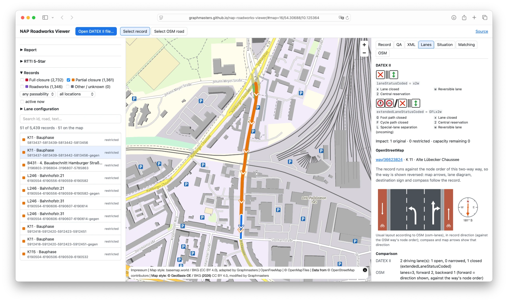

# NAP Roadworks Viewer

Inspect **DATEX II roadworks and road-closure publications** in the browser: XML, schema and
profile checks, a map, OpenStreetMap road lookup, lane comparison and passability analysis.

**Demo:** <https://graphmasters.github.io/nap-roadworks-viewer/>. Open or drop a DATEX II XML file,
plain or gzip-compressed. The file is processed in your browser and is not uploaded.



*Cycle-path works on the K 49 near Puttgarden (Fehmarn). Lanes tab: the DATEX II lane status
(`Fu2o`: cycle path closed, both lanes open) next to the usual OSM layout of the matched way, with a
compass for its direction. Data: [Landesbetrieb Straßenbau und Verkehr Schleswig-Holstein
(LBV.SH)](https://mobilithek.info/offers/110000000003237002) via Mobilithek, licence-free.*

## What it does

| Step | What you get |
|---|---|
| **XML** | Streaming well-formedness check (line and column of the first error). DTDs and external entities are never resolved. |
| **DATEX II detection** | Version (v2 / v3), `modelBaseVersion`, publication type, publication time and creator, SOAP envelope. |
| **XSD validation** | Real schema validation with libxml2 (WebAssembly) against XSD files you select. The UI says "not performed" until you do. |
| **Profile checks** | Profile detection (MDM roadworks profile 04-00-00, NDW situation feeds, generic v2/v3) with heuristic rules, labelled as heuristics. |
| **Extensions** | Official extension mechanisms (v2 `…Extension`, v3 `_…Extension`) apart from other namespaces, with element counts. |
| **Records** | Every `situationRecord` normalised to one model: type, validity, management type, cause links, lane status, location methods. Feeds with lane status codes get a lane-configuration filter (reversible lane, hard shoulder open/closed, narrowed or closed lane, parking lane and restrictions, cycleway and pedestrian path open/closed) with lane-status-viewer icons, which also mark records in the Situation tab. |
| **Map** | Records with `gmlLineString` drawn as lines; point-only records as points marked *approximate*; other location methods listed with a reason. |
| **OSM lookup** | Click a road (zoom ≥ 14): the vector-tile feature id gives the OSM way, and its tags come from the OSM API. |
| **Matching** | Scores OSM road candidates against a record line: score = coverage × quality (distance, direction, road number, class), so candidates that explain more of the record win. Shows the components and, once loaded, each way's OSM lanes as a tiny graphic; reports *ambiguous* or *no match*. Single OSM ways are preferred over merged tile features unless those are clearly better; a merged feature that still wins is split into its OSM ways and scored again. |
| **Lanes** | `laneStatusCoded` / `extendedLaneStatusCoded` diagrams (lane-status-viewer) next to the OSM lane layout (osm-lanes), with quality indicators. A compass rose and arrows on the map show the way direction the OSM layout is drawn in; destination signs appear when the way has `destination:lanes`. |
| **Passability** | Per record: passable, restricted, closed, conditional, conflicting or unknown, plus the routing action (block, do not block, manual review). |
| **OpenLR** | Whether the feed carries OpenLR, per record and in total. Structured OpenLR (DATEX II v3 `openlrLinear`, `openlrPointLocationReference`; v2 `openlrExtendedLinear` / `openlrExtendedPoint`) is decoded: location reference points with coordinates, FRC, form of way, bearing, LFRCNP, DNP, offsets. Its coordinates are checked as WGS 84 decimal degrees (`OLR-001`…`OLR-006`). The inspector lists the points; the map marks them for the selected record. Binary OpenLR is detected, not decoded. |
| **RTTI 5-Star** | Star-level ceilings per criterion of the [TISA RTTI 5-Star Rating Specification](https://tisa.org/rtti-5-star-rating-specification/) for planned and unplanned roadworks and road closures (see below). |

### DQ-RW-001: closure that contradicts its cause

A record that claims a full closure (`roadClosed`, `carriagewayClosures`) whose linked cause record
describes only a stopping/parking prohibition (MDM lane codes `H` / `P`, no closed lane) is flagged as
**DQ-RW-001 – possible incorrect road closure**. The checks are:

1. Resolve `managedCause` links inside the situation. Missing (`REF-001`) and cyclic (`REF-002`)
   references are reported separately.
2. Read the lane evidence of the closure, or of its cause when the closure has none. When
   `laneStatusCoded` and `extendedLaneStatusCoded` disagree, the more restrictive reading wins.
   Unknown codes never count as open lanes.
3. Skip the finding when the validity periods do not overlap.
4. If other records in the situation report a closure for the *same section* (lines overlap within
   30 m) at an overlapping time, say so: the case needs review rather than correction.

The finding never claims the road is passable. It recommends manual review and not blocking the
road in routing on this record alone. `DQ-RW-002` covers a closure whose lane status keeps lanes in
both directions open.

### RTTI 5-Star indicators

The [TISA RTTI 5-Star Rating Specification v1.0](https://tisa.org/rtti-5-star-rating-specification/)
(21 October 2025) rates roadworks and road-closure data per criterion from 1★ to 5★ (Tables 15–18).
The viewer sorts each situation into one of the four use cases and shows, per criterion, the
**highest level this file allows**: a ceiling, not a rating. The feed cannot score higher on that
criterion, but it may score lower once the criteria a file cannot show are measured. TISA's
Evaluation Methodology is not published yet. The viewer shows no overall star value.

| Criterion | Checked in the file | Ceiling |
|---|---|---|
| Data format used | DATEX II version; reference-profile conformance (heuristic, plus your XSD run) | v2 3★, v3 4★, v3 conformant 5★ |
| Use of specification | Record types and value lists of the [DATEX II RTTI reference profile](https://docs.datex2.eu/recommended-profiles/rrp/rtti/); one encoding per category (`RTTI-SPEC-01/02`) | deviation 2★ |
| Terminology & definition | Roadworks keep a lane open, closures close all lanes in a direction (`RTTI-TERM-01`, `DQ-RW-001/002`) | conflict 2★ |
| Location referencing | Best method per record: OpenLR with valid WGS 84 points, ALERT-C, coordinates (`RTTI-LOC-01`) | 5★ / 4★ / 3★ (2★ for unplanned closures) / 0 |
| Linear referencing | A polyline on every record: a `gmlLineString` with at least two distinct positions (a zero-length line is a point), or a structured OpenLR line whose points are valid WGS 84 positions at most 15 km apart (`RTTI-LIN-01/02/03`) | missing 0 |
| ↳ Direction | Only on records with a polyline: is the traffic direction along it unambiguous? Counts: both directions affected; an OpenLR line (its direction section), or OpenLR whose end points match the `gmlLineString` ends within the OpenLR offsets; `aligned`/`opposite` on a linear element given by coordinates; a compass direction matching the polyline bearing. Vertex order alone, ALERT-C direction (relative to the location table) or `aligned` on a coded road are ambiguous (`RTTI-DIR-01`); OpenLR that does not fit the polyline is a contradiction (`RTTI-DIR-02`); references that disagree make it ambiguous (`RTTI-DIR-03`) | not unambiguous 2★ |
| Accuracy | Upper bound from coordinate resolution (significant decimals) (`RTTI-ACC-01`); points far from their own polyline (`RTTI-ACC-02`) | per distance thresholds |
| Correctness | Share of records without internal contradictions | per % thresholds |
| Completeness | Attribute completeness (start, end, polyline, direction, effect or cause), as the spec defines it for events | per % thresholds |
| RTTI event message ID | id, version and version time on every record; no reused ids; probable duplicates (`RTTI-ID-01/02`) | problem 2★ |
| Outdated messages | Age of ended records at `publicationTime` | 24 h 5★ … 4 weeks 1★ |
| Validity, road type, lane level, vehicle classes, cause type | Start/end and schedules (`RTTI-VAL-01`), lane detail per situation, vehicle characteristics, closure causes (`RTTI-CAUSE-01`) | per table |
| Pre-announcement, short-term events | Lead time from creation to start; unplanned works present | shown, no level |
| Update cycle, timeliness, secure API, ID stability | Not visible in one file; the panel says what is needed (repeated downloads, the access URL). Missing creation or version times are reported (`RTTI-TIME-01`) | — |

Assumptions:
- **Planned vs unplanned.** `urgentRoadworks`, else the lead time from `situationRecordCreationTime`
  to `overallStartTime`: 24 h or more is planned. This boundary is the viewer's choice, not the spec's.
- **FRC is unknown.** Direction is required on every record, although the spec asks for it on FRC 3–6
  only. Accuracy, correctness and completeness use the looser of the FRC1–4 and FRC5–6 thresholds.
- **Out of scope** (listed, not rated): moving or mobile maintenance, lane restrictions without a
  roadworks cause, other record types. Static speed limits (Table 13) come via TN-ITS, not in a
  SituationPublication.
- **Capability checks.** Schedules and vehicle classes count once the feed uses them anywhere.
- **Polylines in other coordinate systems.** A `gmlLineString` in another CRS (e.g. `srsName="25833"`)
  counts as a polyline, but its direction and accuracy are not checked (`RTTI-LIN-03`).

**Per record:** the inspector's **QA** tab shows which criteria the selected record holds down and
why, including the rule and message behind each internal contradiction, followed by every finding
about the record. Record links in the RTTI panel open this tab.

To run the checks against your own downloads, point the opt-in test at them:
`DATEX_SAMPLES_DIR="/path/to/feeds" npx vitest run test/samples.test.ts`.

### Sample feeds and their National Access Points

The RTTI and OpenLR checks were tried on downloads from these National Access Points (NAPs). The
repository contains no feed data. The folder names are those `test/samples.test.ts` expects under
`DATEX_SAMPLES_DIR`.

| Folder | Country | Publisher | DATEX II | NAP portal | Data |
|---|---|---|---|---|---|
| `bw` | Germany | Straßenbauverwaltung Baden-Württemberg (MDM roadworks profile) | v2 | [Mobilithek](https://mobilithek.info) | [Offer -5342395678156131804](https://mobilithek.info/offers/-5342395678156131804) (Baustelleninformationen, BEMaS) |
| `sh` | Germany | Landesbetrieb Straßenbau und Verkehr Schleswig-Holstein (LBV.SH) | v2 | [Mobilithek](https://mobilithek.info) | [Offer 110000000003237002](https://mobilithek.info/offers/110000000003237002) |
| `ndw` | Netherlands | NDW: temporary traffic measures and closures; roadworks and events planning feed | v3 | [NTM – Nationaal toegangspunt mobiliteitsdata](https://www.toegangspuntmobiliteit.nl) | [NDW open data](https://opendata.ndw.nu) |
| `no` | Norway | Statens vegvesen (NPRA): road traffic information | v3 | [transportportal.no](https://transportportal.no) | [Road traffic information](https://dataut.vegvesen.no/en/dataset/trafikkmeldinger) (user account required) |
| `dk-copenhagen` | Denmark | Københavns Kommune (identifier `0101`) | v3 | [Dataudveksleren](https://nap.vd.dk) (Vejdirektoratet) | [KBH Kort profiles](https://kbhkort.kk.dk/profiles/) |
| `si` | Slovenia | DARS / NCUP: roadworks, traffic events, safety-related traffic information | v3 | [NAP Slovenia](https://www.nap.si) (NCUP) | [Data sets](https://www.nap.si/en/datasets) |
| `hr` | Croatia | Hrvatski autoklub (HAK), Hrvatske ceste (HC), Autocesta Zagreb–Macelj (AZM) | v2 | [NPT – Croatian National Access Point](https://www.promet-info.hr) (Hrvatske ceste) | – |

## Limitations

- **Location referencing.** Only `gmlLineString` (v2 `linearExtension`, v3 `LinearLocation`) in
  WGS 84 degrees is drawn as a line. AlertC, TPEG and linear-element references are listed, not
  decoded. Structured OpenLR is decoded and its points are marked for the selected record, but OpenLR
  is not map-matched into a line; binary OpenLR is not decoded.
  The `posList` axis order is "lat lon" per EPSG:4326. "lon lat" files are detected from explicit
  latitude/longitude points of the same records, or can be set by hand.
- **Profile checks are heuristic.** They come from the profile documentation and observed feeds. They
  are no conformance test. Use XSD validation for schema conformance.
- **OSM ids from tiles.** OpenFreeMap tiles are built with planetiler, which encodes
  `osmId × 10 + type`. Features merged from several ways (suffix 0) are common even at zoom 14,
  and their id names only the first way. For those the viewer looks up the clicked way by location
  with a ~25 m bounding-box query to the OSM API.
- **Matching** samples the record line and scores candidates read straight from the z14 vector tiles
  along the record (up to 150 tiles; the visible map does not move). z14 is the highest zoom of
  OpenFreeMap, so these are the geometries the map shows. Score = coverage × quality: the quality of
  the covered part (distance 0.3, direction 0.45, road number 0.15, class 0.1) multiplied by the
  share of the record within 25 m. Ways join the explaining sequence on quality (≥ 0.6), so several
  ways can share a long record. A merged tile feature ranks 0.1 lower than its score, so a single
  OSM way within that margin wins; a runner-up on the same road (within 3 m) does not make the match
  ambiguous. The score ranks candidates; it is not a calibrated probability. When the best candidate is a merged tile feature, the viewer asks Overpass for the
  ways with the same `highway` value (from the tile's road class) inside the part of the record that
  feature covers, and scores them in its place (up to 3 rounds). Boxes up to 500 × 500 m are asked
  from the OSM API first, then from Overpass. Larger boxes go to `overpass-api.de` first, then, up to
  0.0005 square degrees, to the OSM API, then to `overpass.private.coffee`. If all fail, the merged
  feature is kept and marked as such.
- **Lanes.** OSM lane tags describe the usual layout and DATEX II a temporary one. A difference is a
  hint, not an error. Direction mapping between DATEX II and OSM is not verified.
- **Size.** Files are streamed in a Web Worker. A 209 MB (16 MB gzipped) feed with 61 000 records
  works but needs several hundred MB of memory. XSD validation loads the whole document (max 400 MB).

## Privacy

- The DATEX II file is read and analysed locally (Web Worker). It is not uploaded or stored.
- Map tiles come from OpenFreeMap. The map style and sprites come from the
  [basemap-world-openfreemap](https://github.com/Graphmasters/basemap-world-openfreemap) GitHub Pages site.
- Requests to the OSM API (`api.openstreetmap.org`) are made only when you select a road, use a
  matching candidate or run matching. They contain a way id or a small bounding box, never data from
  your file.
- Matching may query Overpass (`overpass-api.de`, as fallback `overpass.private.coffee`) or the OSM
  API with a road class and the bounding box of the matched part of the record. No other data from
  your file is sent.

## Library

The analysis runs without the UI, in the browser or in Node.js ≥ 20:

```sh
npm install @graphmasters/nap-roadworks-viewer   # not yet published; build from source meanwhile
```

```ts
import { openAsBlob } from 'node:fs'
import { analyseDatex } from '@graphmasters/nap-roadworks-viewer'

const blob = await openAsBlob('feed.xml.gz')
const result = await analyseDatex({ size: blob.size, stream: () => blob.stream() })

result.wellFormed                 // { ok: true } or the first error with line/column
result.meta                       // version, publication type, namespaces, extensions, axis order
result.events                     // normalised records (GeoJSON geometry, lanes, validity, …)
result.findings                   // findings with rule id, severity, layer, xmlPath
result.recordPassability          // per record: classification, routing action, reasons
result.passability                // DQ-RW-001 / DQ-RW-002 findings with evidence and assumptions
```

Other exports: `runChecks` (re-run with another profile), `extractText` (original XML of a record by
character offsets), `summariseLaneCode`, `compareLanes`, `osmLaneAttributes` and `matchEvent`.

## Development

```sh
git clone https://github.com/Graphmasters/nap-roadworks-viewer.git
npm ci
npm run dev          # http://localhost:5173/nap-roadworks-viewer/
npm test             # Vitest, synthetic DATEX II fixtures in test/fixtures.ts
npm run typecheck
npm run build        # library → dist/
npm run build:app    # GitHub Pages site → _site/
```

Lane interpretation, tile feature ids and the OSM API client come from the
[osm-lanes](https://www.npmjs.com/package/osm-lanes) npm package.

The repository contains no real feed data. Tests use small, hand-written XML documents.

## Licence and attribution

Apache License 2.0, see [LICENSE](LICENSE) and [NOTICE](NOTICE). Third-party components and data
credits are listed in [ATTRIBUTION.md](ATTRIBUTION.md). Map: © OpenStreetMap contributors (ODbL),
OpenMapTiles, OpenFreeMap; map style basemap.world / BKG (CC BY 4.0), adapted by Graphmasters.

When you publish screenshots or results from a DATEX II feed, credit its publisher as their
licence requires.

> [!NOTE]
> The code in this repository was generated with [Claude](https://www.anthropic.com/claude)
> (Anthropic) under human direction and review.
